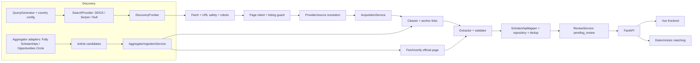

# Polaris: Review Codebase dan Rekomendasi Lanjutan

**Snapshot kerja:** 1 November 2026  
**Branch:** `develop`  
**Tujuan dokumen:** menjelaskan alur produk dan akuisisi yang benar-benar ada, batas yang sudah diverifikasi, lalu memberi urutan kerja berikutnya.

> Working tree saat review sudah berisi banyak perubahan lokal, baik tracked maupun untracked. Dokumen ini tidak menganggap seluruh perubahan itu dibuat dalam satu rangkaian kerja dan tidak menyarankan reset, clean, atau penggantian file.

## Ringkasan

Polaris adalah aplikasi katalog dan pencocokan beasiswa yang ditopang knowledge pipeline. Frontend melayani pencarian, detail, matching deterministik, compare, dan shortlist. Backend mengumpulkan kandidat, mengklasifikasikan halaman, mengambil bukti, mengekstrak fakta, memvalidasi, melakukan dedup, lalu memasukkan record yang lolos ke jalur review. Record baru tidak semestinya langsung dipublikasikan.

Masalah utama saat ini bukan ketiadaan komponen. Banyak bagian pipeline sudah ada, tetapi belum ada bukti terkini bahwa pencarian publik berhasil mengalir sampai record baru di `pending_review`. Secara historis beberapa run terakhir mencatat semua query gagal dan nol hasil; metrik lama tidak menyimpan kategori error. Ada provider DDGS yang bisa merespons probe terbatas, namun probe itu hanya menemukan tautan agregator—belum membuktikan akuisisi beasiswa. Eksperimen penuh belum dilakukan karena jaringan sumber publik ditolak dan PostgreSQL scratch tidak tersedia.

Perubahan terbaru memperbaiki klasifikasi detail halaman dalam bahasa yang dikonfigurasi dan memperbesar jatah query lokal. Unit test untuk jalur terkait lulus, tetapi keberhasilan akuisisi live tetap belum terverifikasi.

## Peta sistem



Diagram menunjukkan konsep pipeline, bukan jaminan semua cabang terhubung otomatis. Jalur country exploration dan runner aggregator saat ini terpisah secara operasional.

## Arsitektur dan alur yang ada

### Aplikasi

- Backend memakai FastAPI, Pydantic, SQLAlchemy, dan PostgreSQL. API publik untuk scholarship mengambil record yang approved melalui publication filter.
- Frontend memakai Vue 3 dan Vite. Alur utama: home/discover, detail, matching, compare, saved shortlist, about.
- `README.md` saat snapshot ini kosong, jadi setup lokal, alur kerja, dan perintah aman menjalankan pipeline belum punya pintu masuk utama.
- Matching dilakukan secara deterministik berdasarkan profil pelamar; bukan bagian dari akuisisi dan sebaiknya tidak diubah saat fokus kerja adalah kualitas katalog.
- Detail API memiliki provenance/freshness, tetapi UI belum menampilkan semua informasi verifikasi yang tersedia. Pencarian katalog juga belum memiliki semua filter yang diharapkan seperti funding, field, atau deadline.

### Country exploration

Entry point utama berada di `services/exploration/engine.py` dan `scripts/run_country_exploration.py`:

1. `QueryGenerator` membentuk query dari konfigurasi `configs/countries/*.json`.
2. Search provider memberi hasil yang dicatat ke `DiscoveryFrontier` beserta query, posisi, dan snippet.
3. Candidate dianalisis, diklasifikasikan sebagai scholarship/job/other, lalu provider dan sumber diselesaikan.
4. `AcquisitionService` fetch halaman sumber, menerapkan page-intent/listing gate, mencari halaman beasiswa, lalu memanggil extractor dan validator.
5. Mapper/repository menyelesaikan referensi, identitas, dedup, dan menyimpan record. Review service menjaga record baru di antrean review.

Engine memiliki metrik run untuk query, hasil, frontier, fetch, intent, listing, extraction, provider/source resolution, persistence, dan beberapa sampel provenance. Kualitas metrik historis tidak seragam; kategori kegagalan search baru dicatat pada run berikutnya setelah perbaikan observability.

### Run per country: cara menjalankan dan membaca hasil

Entry point CLI saat ini:

```powershell
.venv\Scripts\python.exe scripts/run_country_exploration.py JP --report --max-runtime 15
```

Ganti `JP` dengan ISO2 negara yang ada di `configs/countries/` (misalnya `KR`, `CN`, `ID`, `DE`, `FR`, `SG`). Script membaca `DATABASE_URL` dari environment/`.env`, memerlukan row negara tersebut di database, lalu menjalankan bounded engine. Provider default adalah DDGS; provider bisa dipilih lewat `POLARIS_SEARCH_PROVIDER` (`ddgs`, `serper`, atau `null`). `serper` perlu credential. Batas waktu bisa dioverride, tetapi jumlah halaman, kedalaman, retry, dan fetch per domain berasal dari country config.

Urutan yang dilakukan satu run:

1. Hitung run sebelumnya untuk negara itu, lalu rotasikan query agar run selanjutnya tidak mengulang persis kombinasi yang sama.
2. Jalankan query web search dan masukkan URL ke frontier dengan provenance query, provider, rank, dan snippet.
3. Tambahkan `seed_urls` dari config dan sampai 20 source aktif/provisional yang sudah tersimpan untuk negara tersebut.
4. Proses frontier sampai batas waktu/halaman: fetch, klasifikasi peluang, tolak job/halaman tak relevan, selesaikan provider/source, lalu akuisisi halaman beasiswa dan simpan hasil yang lolos melalui pipeline review.
5. Commit run/frontier/acquisition state dan cetak metrik jika `--report` diberikan. Report membedakan kerja run ini dari ukuran antrean review negara saat ini.

Metrik yang perlu dibaca berurutan: `queries_executed` dan `queries_failed` → `search_results` → `candidates_created` → `pages_fetched` → label klasifikasi → `authority_resolved`/`sources_verified` → `extraction_succeeded` dan `extraction_failures` → `scholarships_persisted`/`duplicates_collapsed` → jumlah `pending_review`. Jika sebuah tahap bernilai nol, jangan menaikkan budget dulu: periksa provider/config, kategori error, kandidat frontier, dan blocker tahap itu.

**Batas penting:** CLI country exploration memakai `DATABASE_URL` biasa dan melakukan commit. Belum ada guard `_test`/`_scratch` seperti pada runner aggregator. Opsi `--dry-run` hanya memilih `NullSearchProvider`; engine tetap membuka database, membuat run/frontier, menambahkan seed dan known sources, dan bisa memproses/mengambil halaman tersebut. Jadi `--dry-run` bukan mode read-only, bukan simulasi tanpa database, dan belum tentu tanpa network. Jangan jalankan terhadap database development/production untuk eksperimen. Jalankan hanya setelah environment proses diarahkan ke database scratch lokal yang schema dan country reference-nya sudah siap.

Contoh dengan scratch (ganti kredensial melalui secret store/environment lokal; jangan taruh di command history atau commit):

```powershell
$env:DATABASE_URL = $env:POLARIS_COUNTRY_TEST_DATABASE_URL
.venv\Scripts\python.exe scripts/run_country_exploration.py JP --report --max-runtime 15
```

Sebelum menjalankan, pastikan `POLARIS_COUNTRY_TEST_DATABASE_URL` menunjuk PostgreSQL lokal khusus eksperimen dengan suffix `_test`/`_scratch`, schema sudah dimigrasikan dan row negara tersedia. Saat ini script belum memvalidasi syarat tersebut; yang diverifikasi baru nilai environment oleh operator. Karena itu rekomendasi implementasi berikutnya adalah memberi country runner argumen/env khusus scratch dengan validasi backend, host, dan suffix seperti aggregator runner, plus mode `--plan-only` yang tidak membuka DB dan mode offline yang benar-benar tidak fetch.

### Country exploration dan aggregator: dipakai bersama, tetapi belum terorkestrasi

| Jalur | Pertanyaan yang dijawab | Bergantung pada country config? | Dampak |
|---|---|---:|---|
| Run per country | Beasiswa/sumber apa yang ditemukan untuk ekosistem negara ini? | Ya | Search web + known sources/seeds, klasifikasi provider/source, lalu acquisition |
| Aggregator discovery | Artikel peluang apa yang dapat ditelusuri kembali ke provider resminya? | Tidak | Archive aggregator → artikel → official page → review pipeline |

Keduanya melayani discovery yang berbeda dan tidak saling menggantikan. Run negara berguna untuk menemukan sumber institusional serta peluang yang terindeks mesin pencari; aggregator dapat menemukan nama program lintas negara dari daftar editorial. Saat ini runner dan jadwalnya terpisah. Jalankan berurutan pada scratch DB yang sama hanya setelah koneksi, batas akses, dan schema dipastikan aman. Dedup bersama harus diuji dengan identity key yang sama, bukan diasumsikan dari fakta bahwa kedua service memakai repository yang sama.

### Aggregator discovery

- `services/aggregator_discovery/adapters.py` membaca HTML archive/feed dengan batas halaman, pagination, URL canonicalization, dan dedup dalam satu run.
- `configs/aggregators.json` berisi Fully Scholarships dan Opportunities Circle. Keduanya merupakan discovery reference, bukan provider beasiswa resmi.
- `AggregatorIngestionService` menyimpan bukti artikel, mengklasifikasikan halaman, mencari URL resmi dan URL aplikasi secara terpisah, mengambil halaman resmi, lalu mencoba validasi/resolusi/dedup/persistensi.
- `services/ingestion/cleaner.py` mempertahankan href anchor agar extractor dapat melihat target tautan.
- `scripts/run_aggregator_discovery.py` menyediakan mode discovery-only dan mode bounded persistence. Mode persist menuntut `POLARIS_AGGREGATOR_TEST_DATABASE_URL` ke PostgreSQL lokal bernama akhiran `_test` atau `_scratch`; tidak fallback ke `DATABASE_URL`, tidak membuat tabel, dan tidak menjalankan migrasi.

Aggregator runner belum menjadi job terjadwal dan tidak otomatis dipanggil oleh country exploration. Karena itu keberadaan adapter/config belum berarti sumber-sumber itu aktif mengisi review queue.

### Review dan publication boundary

`ReviewService` dan model review action/version menangani submission, keputusan reviewer, koreksi, serta kandidat revisi. `pending_review` adalah status record internal; hanya record yang melewati keputusan approval dapat tampil melalui API publik. Kegagalan verifikasi sumber atau fakta yang belum terpecahkan seharusnya tetap terlihat sebagai blocker/evidence di review packet, bukan ditebak atau dipublikasikan.

## Akuisisi multibahasa

Sembilan konfigurasi negara saat ini mengaktifkan bahasa Inggris dan sebagian mengaktifkan Jepang, Korea, Mandarin, Indonesia, Jerman, atau Prancis. Sebelumnya query lokal hanya mendapat porsi kecil dari budget, sementara `page_intent` banyak bergantung pada kosakata Inggris. Reproduksi fixture menunjukkan detail beasiswa Jepang dan Mandarin jatuh ke `UNKNOWN`; Korea dan Indonesia jatuh ke `OVERVIEW` karena sinyal eligibility/benefit/deadline tidak dikenali.

Perbaikan terbaru:

- `page_intent.py` mengenali sinyal judul/funding, kelayakan, manfaat, tenggat, aplikasi, penerima, dan label koleksi untuk Jepang, Korea, Mandarin, Indonesia, Jerman, dan Prancis.
- `QueryGenerator` menyisihkan dua slot query lokal dari budget yang sudah ada untuk setiap negara dengan bahasa non-Inggris. Tidak ada tambahan jumlah query per run.
- Test fixture memastikan detail multibahasa dapat diklasifikasikan sebagai detail, sementara halaman daftar tetap overview.

Ini baru menutup satu tahap. `real_extractor.py` masih mengandalkan banyak pola berbahasa Inggris untuk nama beasiswa, provider, deadline, degree, funding, dan negara. Maka classifier dapat menerima halaman yang extractor-nya tetap gagal atau menghasilkan field kosong. Jangan menganggap cakupan bahasa setara dengan kualitas ekstraksi multilingual penuh.

## Snapshot bukti dan batasan

### Katalog/database yang diperiksa read-only

Snapshot PostgreSQL lokal sebelumnya menunjukkan 259 scholarship record: 41 approved, 60 pending review, 157 rejected, dan 1 needs correction. Dari 41 approved, terdapat 8 negara tujuan dan 15 provider. Sebagian field katalog masih jarang: 35/41 memiliki degree, 17/41 funding type, 28/41 field of study, dan 40/41 application URL. Semua record punya official URL pada snapshot itu. Tidak ditemukan kelompok duplikat pada `identity_key`.

Snapshot tersebut hanya potret pada waktu pemeriksaan; bukan jaminan isi database belum berubah. Tidak ada query tulis yang dilakukan selama review ini. Dokumen milestone lama—misalnya `docs/progress/V0.1-PRODUCTION-CUT.md`—mencatat angka awal yang berbeda dan harus dibaca sebagai laporan historis, bukan angka katalog sekarang.

### Acquisition evidence

- Delapan run eksplorasi terakhir yang ditinjau sebelumnya mencatat seluruh query gagal, nol search result, dan nol authority candidate. Catatan historis hanya punya hitungan, bukan alasan kegagalan, sehingga root cause provider untuk run lama tidak dapat dipastikan.
- DDGS pernah merespons probe terbatas dan memberi tiga URL dari agregator. Itu membuktikan search provider mengembalikan hasil, bukan bahwa artikel valid, sumber resmi terverifikasi, atau record berhasil masuk review.
- Percobaan fetch aggregator berikutnya ditolak oleh lingkungan (`WinError 10061`).
- `POLARIS_AGGREGATOR_TEST_DATABASE_URL` tidak tersedia saat pemeriksaan. Tidak ada fetch/crawl penuh, persistence, migrasi, atau penulisan database dilakukan.

### Validasi kode terbaru

- 224 unit test yang mencakup page intent, query generation, opportunity classifier, extraction quality, acquisition policy/listing guard, extractor, aggregator discovery/ingestion/runner lulus.
- Ruff lulus pada file yang disentuh untuk perbaikan multilingual.
- Seluruh `tests/unit` pernah dijalankan dengan root `conftest.py` sengaja dikecualikan untuk menghindari fixture yang dapat mengakses DB development: 753 lulus, 18 error setup karena fixture root yang dibutuhkan beberapa test tidak tersedia. Ini bukan hasil full-suite yang bersih.
- Integration test Postgres scratch dan alur live belum dijalankan.

## Rekomendasi urutan kerja

### 1. Amankan run per country sebelum eksperimen

Tambahkan validasi scratch database ke `run_country_exploration.py` atau entrypoint khusus sehingga ia menolak database non-lokal/tanpa suffix `_test`/`_scratch` saat eksperimen. Pisahkan `--plan-only` dari `--dry-run`: yang pertama hanya mencetak konfigurasi/query tanpa DB dan network; yang kedua harus punya semantik eksplisit, tidak mengakses network, dan tidak menulis DB. Tambahkan tes bahwa tidak ada fallback ke `DATABASE_URL` default. Run per country adalah jalur utama yang sudah punya metrik funnel lebih lengkap, tetapi saat ini batas keselamatan database-nya lebih lemah daripada runner aggregator.

### 2. Buktikan satu funnel nyata secara terisolasi

Prioritas tertinggi. Siapkan database PostgreSQL disposable yang sudah memiliki schema sesuai migration terpasang, dengan nama berakhiran `_test` atau `_scratch`. Jalankan `--discover-only` terlebih dahulu, tinjau kandidat dan aturan akses situs, lalu jalankan persist hanya dengan URL scratch eksplisit. Ukur setiap tahap: archive pages fetched, article candidates unik, intent/listing verdict, artikel fetched, official links ditemukan, official pages fetched/verified, extraction valid, destination/provider resolved, duplikat, record baru `pending_review`, dan blockers.

Kriteria selesai: setidaknya satu kesempatan beasiswa nyata diverifikasi pada provider page, fakta diekstrak, lolos validator, lolos dedup, dan tercatat pending review. Jika gagal, perbaiki tahap pertama yang gagal berdasarkan bukti run. Jangan menambah banyak sumber sebelum satu funnel berjalan end-to-end.

### 3. Tambahkan integration test sukses dan idempotency

Test terisolasi yang ada membuktikan kandidat ambigu tidak menjadi scholarship, tetapi belum membuktikan kasus sukses sampai `pending_review`. Tambahkan fixture artikel aggregator + halaman resmi yang berbeda, link aplikasi opsional, provider/country evidence yang jelas, lalu jalankan service terhadap Postgres disposable. Jalankan input yang sama dua kali dan pastikan tidak membuat duplikat atau mengubah record approved. Pastikan aggregator URL tidak pernah dipakai sebagai `official_page_url` atau application URL.

### 4. Lengkapi ekstraksi multibahasa berdasarkan fixture

Ambil halaman publik nyata secara terbatas untuk setiap bahasa aktif. Simpan snapshot/fixture dengan provenance. Ukur per field, bukan satu skor umum: scholarship name, provider, destination country, deadline, degree, funding, eligibility, official URL, application URL. Implementasikan pola tanggal lokal dan kosakata per bahasa secara teruji. Untuk bahasa yang belum didukung field tertentu, biarkan null dan pertahankan evidence untuk reviewer daripada mengarang translasi atau fakta.

### 5. Operasionalkan akuisisi dan observability

Setelah funnel berhasil, putuskan jadwal/batch kecil untuk aggregator dan bagaimana aggregator observations diteruskan ke source verification/exploration. Simpan kategori kegagalan, stage counters, waktu fetch, dan blocker tanpa menyimpan secrets atau payload yang tidak perlu. Dashboard operasional pertama cukup menjawab: apa yang ditemukan, di tahap mana kandidat gagal, dan apa yang masuk antrean review.

### 6. Naikkan kualitas katalog dan transparansi pengguna

Setelah pertumbuhan review queue terukur, prioritaskan verifikasi ulang record approved, kelengkapan deadline/funding/degree, pemisahan official/application links yang konsisten, serta tampilan `last_verified_at` dan sumber di detail. Tambahkan filter funding/field/deadline bila data serta kontrak API sudah mendukungnya. Pertahankan UI dan matching tetap sederhana; jangan mulai chatbot atau redesign besar sebelum data acquisition stabil.

Sesudah langkah tersebut, isi README dengan quickstart, konfigurasi environment tanpa credential, mode unit test yang tidak membuka DB, prosedur Postgres scratch, dan tautan ke dokumen arsitektur/progress yang masih berlaku. Tandai milestone lama sebagai historis supaya angka lama tidak disalahartikan sebagai keadaan sekarang.

## Langkah paling masuk akal berikutnya

Pertama, amankan country runner dengan scratch guard dan mode plan-only yang jujur. Lalu jalankan satu eksperimen negara (JP atau KR, karena sudah ada fixture intent multibahasa) dan batch **3 artikel per aggregator** secara berurutan pada database disposable. Bandingkan funnel kedua jalur dan telusuri blocker pertama yang berbeda. Hasil itu akan menunjukkan apakah bottleneck ada pada search, akses situs, ekstraksi anchor, klasifikasi intent, resolver provider/negara, atau mapping/repository. Itu dasar paling kuat untuk iterasi berikutnya.
